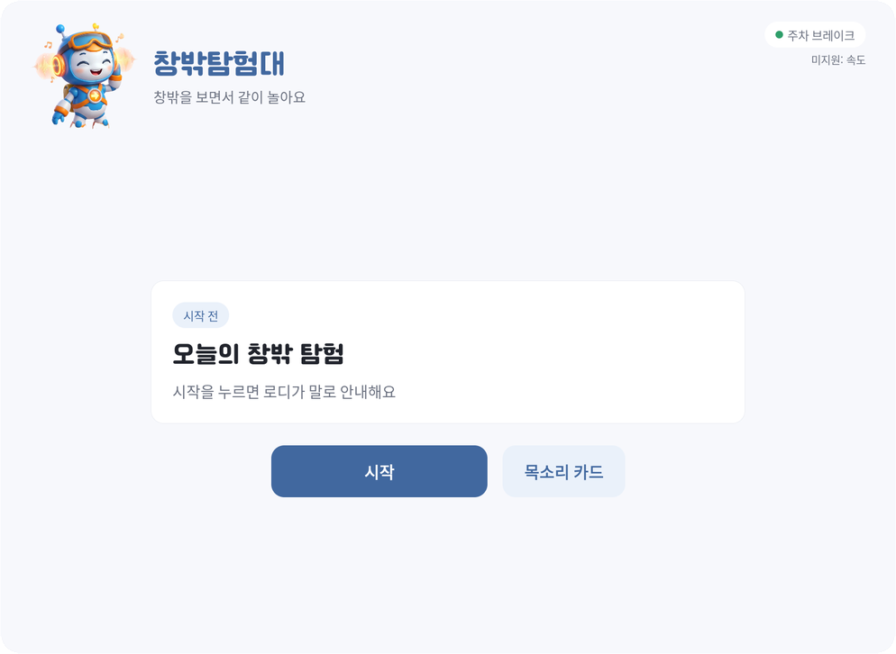
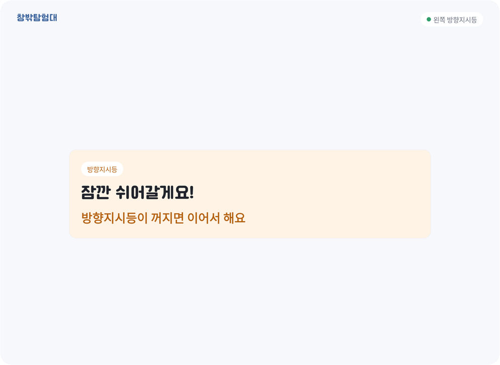
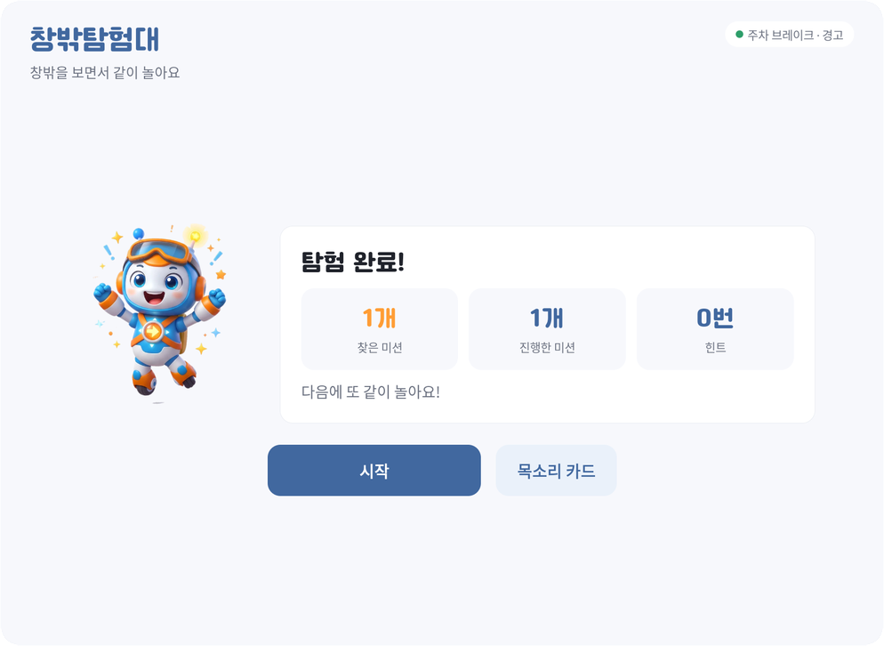
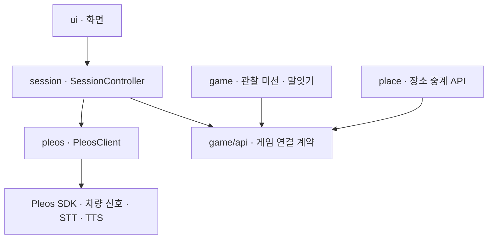

  

<h1 align="center">창밖탐험대</h1>

  <b>화면 속 세상 말고, 진짜 세상에서 놀자.</b> 
  "아빠, 언제 도착해?"에서 "벌써 도착했어?"로.

## 한 줄 소개

뒷좌석 아이가 창밖을 보며 목소리로 미션을 푸는 차량용 놀이 앱입니다. 방향지시등·브레이크·경고 같은 차량 신호에 맞춰 스스로 말을 멈추고, 도착하면 "벌써 도착했어요!"로 마무리합니다.

| 시작 화면 (주차 중) | 주행 중 방향지시등 멈춤 | 탐험 완료 |
|:---:|:---:|:---:|
|  |  |  |

## 1. 프로젝트 소개

창밖탐험대는 자동차로 이동하는 동안 지루해하는 어린이와 동승자를 위한 음성 기반 차량 놀이 서비스입니다.

스마트폰 화면에 시선을 고정하는 대신, 실제 도로와 주변 풍경을 탐험 대상으로 씁니다.

아이는 창밖을 관찰하고 목소리로 미션에 답합니다. 마스코트 로디는 아이의 대답을 기다리고, 맞히면 칭찬하고, 막히면 힌트를 줍니다.

Pleos Connect(Android Automotive OS)에서 동작하며, 차량 신호와 내비게이션 정보를 직접 받아 놀이 흐름을 조절합니다.

## 2. 기획 배경

자동차 이동 시간은 가족이 함께하는 시간이지만, 어린이에게는 반복적이고 지루한 시간이 되기도 합니다.

창밖탐험대는 이 시간을 그냥 흘려보내지 않고, 주변을 발견하며 가족이 함께 경험하는 시간으로 바꾸려고 기획했습니다.

차 안에서 노는 앱이라면 운전을 방해하지 않아야 합니다. 그래서 주행 중에는 화면 대신 목소리로만 놀고, 차량 신호가 오면 앱이 먼저 말을 멈추도록 설계했습니다.

## 3. 핵심 기능

### 창밖 관찰 미션

아이가 고른 난이도에 따라 창밖에서 찾을 것을 냅니다.

| 난이도 | 미션 예시 |
|---|---|
| 초급 | 창밖에서 물건 찾기 — 빨간 차, 버스, 신호등, 나무, 건물, 자전거 |
| 중급 | 간판에서 글자 찾기 — "'약' 자가 들어간 간판을 찾아볼까요?" |
| 고급 | 간판에서 단어 찾기 — 특정 단어가 들어간 간판 |

- 관찰 미션 3개마다 연상 말잇기("원숭이 엉덩이는 빨개") 한 판이 이어집니다.
- 보호자가 위치 이용에 동의하면, 진행 방향 앞 150~500m에 있는 실제 가게 이름으로 미션을 냅니다. 동의 전이거나 장소를 못 받으면 기본 미션으로 이어집니다.

### 목소리로 하는 놀이

- 난이도와 정답은 모두 말로 답합니다. 주차 중에는 화면 버튼으로도 고를 수 있습니다.
- "다시 말해 줘", "잠깐 쉬자", "다시 하자", "그만할래"로 놀이를 조절합니다.
- 대답이 없거나 알아듣지 못하면 다시 묻고, 그래도 어려우면 힌트를 줍니다.

### 차량 신호에 맞춘 안전 멈춤

차량 상태에 따라 앱이 스스로 말을 멈추고 다시 이어 갑니다. 신호가 꺼지면 끊긴 문장부터 다시 말합니다.

| 차량 신호 | 앱의 동작 |
|---|---|
| 방향지시등 | 주차 중이 아니면 멈춤. 꺼지면 1초 뒤 이어서 |
| 브레이크 | 주행 중일 때만 멈춤 |
| 비상등 · 다른 음성 안내(내비 등) | 언제나 멈춤 |
| 차량 경고 | 소리 없이 종료 |
| 주차 상태가 아님 | 새 놀이를 시작할 수 없음 |

### 아이 목소리 카드

보호자가 동의하면 주차 중에 아이 목소리를 녹음해 둘 수 있습니다. 녹음은 이 기기에만 저장됩니다.

| 상황 | 재생되는 카드 |
|---|---|
| 정차 중 와이퍼를 켤 때 | "와이퍼 출동!" |
| 도착해서 주차 브레이크를 걸 때 | "벌써 도착!" |
| 주차 중 문을 열 때 | "다녀오세요!" |

녹음이 없으면 같은 문장을 음성 합성으로 말합니다.

### 벌써 도착 마무리

내비게이션 도착에 맞춰 놀이를 마무리합니다. 찾은 미션, 진행한 미션, 힌트 수를 결과 화면으로 보여 주며, 결과는 주차한 뒤에 볼 수 있습니다.

### 마스코트 로디와 주행 환경 화면

  

- 주차 중에는 로디가 놀이 상태에 맞는 포즈로 함께합니다.
- 차량 신호로 멈추면 "쉿!" 포즈를 하고, 쉬자고 하면 앉아서 쉽니다. 정답을 맞히면 점프합니다.
- 방향지시등을 켜면 가슴 엠블럼의 화살표와 손가락이 그 방향을 가리킵니다. 경고등이 켜져 시작할 수 없으면 손바닥으로 멈춤을 알립니다.
- 주행 중에는 로디와 버튼을 숨기고 현재 미션과 진행 상태만 크게 보여 줍니다. 터치가 필요한 화면은 주차 중에만 열립니다.

## 4. 서비스 핵심 가치

- 실제 주변 환경을 콘텐츠로 활용
- 화면보다 음성을 중심으로 하는 참여 경험
- 어린이의 반응 속도와 특성을 고려한 대화
- 운전자의 주의 분산을 최소화하는 인터페이스

## 5. 기술 구현 및 아키텍처

| 구분 | 사용 기술 | 역할 |
|---|---|---|
| 앱 | Kotlin, Jetpack Compose, Android Automotive OS(Pleos Connect) | 화면, 이용 흐름, 놀이 진행 |
| 서버 | 장소 검색 중계 API (이 저장소 밖) | 카카오 장소 검색 API 키를 서버에만 두고, 앱에는 앞쪽 장소 이름만 전달 |
| 대화 | 규칙 기반 반응 (LLM 미사용) | 정답·오답·무응답·음성 명령을 판별해 다음 대사를 정함. 네트워크 없이 기기 안에서 동작 |
| 음성 인식 | Pleos SDK STT (ON_DEVICE) | 아이의 대답을 문장으로 변환 |
| 음성 합성 | Pleos SDK TTS (ON_DEVICE) | 미션 안내와 칭찬을 읽어 줌 |
| 차량 연동 | Pleos SDK Vehicle · NaviHelper · FusedLocation | 기어·속도·방향지시등·브레이크·비상등·와이퍼·문·경고, 내비 도착, 위치(동의 뒤에만) |
| 검증 | GitHub Actions | 커밋마다 포맷 검사, 단위 테스트, Lint, 커버리지, release 빌드 |

### 데이터 흐름

1. `pleos/`가 Pleos SDK에서 차량 신호와 음성 인식 결과를 받아 옵니다.
2. `session/`의 SessionController가 "주행 상태 × 신호 결정표"로 시작·멈춤·휴식·종료를 정합니다.
3. `game/`은 아이의 대답을 받아 다음에 할 말과 미션을 돌려줍니다. 게임은 차량과 화면을 모릅니다.
4. `ui/`는 지금 상태만 그립니다. 주행 중이면 요약만, 주차 중이면 버튼과 로디까지 보여 줍니다.

자세한 구조는 [구조 안내](docs/architecture.md)와 [아키텍처 설계서](docs/backseat-system-architecture.md)에 있습니다.

## 6. 구현 범위

### 실제 구현 · 시연 가능
- 관찰 미션 3단계, 연상 말잇기, 음성 명령(다시·쉬기·이어 하기·그만하기)
- 차량 신호에 따른 멈춤·재개·무음 종료, 주차 중에만 시작
- 내비 도착 마무리와 결과 화면
- 아이 목소리 카드 녹음·삭제·동의 철회, 차량 이벤트 재생
- 위치 동의 후 장소 미션 (중계 서버를 켰을 때)
- 주행 중 화면 제한(요약만, 터치 UI 없음)

### 시뮬레이션으로 확인
- 차량 신호는 Pleos Connect Emulator의 Virtual Console로 바꿉니다. 디버그 빌드에서는 `./scripts/sim.sh`로 신호와 음성 인식 결과를 넣어 시나리오를 자동으로 재현합니다.
- 장소 중계 서버는 시연 PC에서 로컬로 실행합니다(에뮬레이터에서 `http://10.0.2.2:8080`). 서버가 꺼져 있어도 기본 미션으로 이어집니다.

### 향후 확장 계획
- 도착 예언가: 출발할 때 "몇 분 걸릴까요?"를 묻고 도착할 때 실제 시간과 비교
- 다음 길은 어디로?: 내비 회전 안내로 다음 방향을 맞히는 미션
- 내비 안내 판별: 길 안내 중임을 구분해 멈춤 사유를 더 구체적으로 표시
- 세션 기록: 미션별 결과·걸린 시간·힌트를 기기 안에 기록

## 7. 실행 방법

1. Android Studio에서 이 저장소를 열고 Pleos Connect Emulator(아래 환경)를 켭니다. 설정은 [Windows](docs/setup-windows.md) / [Mac](docs/setup-mac.md).
2. APK를 설치합니다: `adb install -r apk/BackseatLab_창밖탐험대_release.apk` (소스에서 빌드하려면 `./gradlew assembleRelease`).
3. 앱 "창밖탐험대"를 열고, Virtual Console에서 주차(P단)로 둔 뒤 마이크 권한을 허용하고 시작 버튼을 누릅니다.
4. 출발(D단)·방향지시등·브레이크를 바꿔 보면 앱이 멈추고 다시 이어 갑니다. 내비 도착이나 주차로 마무리하면 결과 화면이 나옵니다.

디버그 빌드에서는 `./scripts/sim.sh <이벤트>`로 차량 신호를 흉내 낼 수 있습니다(예: `brake-on`, `turn-left`, `park-on`, `nav-arrive`).

### 테스트 환경 · 필요한 설정
- Pleos Connect Emulator 2.1.0, AVD: Automotive / Pleos Connect v2.1.0 / API 34 / Cold boot / RAM 4GB
- 앱: minSdk 28, Kotlin, 한국어 전용. 음성 인식·합성은 ON_DEVICE 모드(앱 등록·네트워크 불필요)
- 마이크 권한 필요. 위치 기반 장소 미션은 앱 안의 동의 버튼을 눌렀을 때만 켜지며, 동의 전이나 서버가 없으면 기본 미션으로 진행합니다([중계 API](docs/api-places.md)).
- 개발 도구: Android Studio 최신, Gradle 래퍼 포함

### APK
- 위치: `apk/BackseatLab_창밖탐험대_release.apk` (release 서명 빌드)

### 개발자용
- 빠른 검사(포맷 + 단위 테스트): `./scripts/check.sh`
- 에뮬레이터 실화면 검증: `./scripts/verify-emulator.sh`
- 요구사항: [공통 이용 흐름 요구사항](docs/backseat-core-requirements.md) · [기능 목록](docs/features.md)
- 팀원은 [개발 하네스 안내](docs/harness.md)를 먼저 읽어 주세요.

## 8. 팀 구성

| GitHub | 역할 |
|---|---|
| [Chyoung812](https://github.com/Chyoung812) | 팀장 · 아이디어 기획 · 개발 · 시연 영상 |
| [jeunju528-sudo](https://github.com/jeunju528-sudo) | 아이디어 디벨롭 · 개발 |
| [Jaeukss](https://github.com/Jaeukss) | 기획 · 숏폼 영상 · 로디 디자인 |
