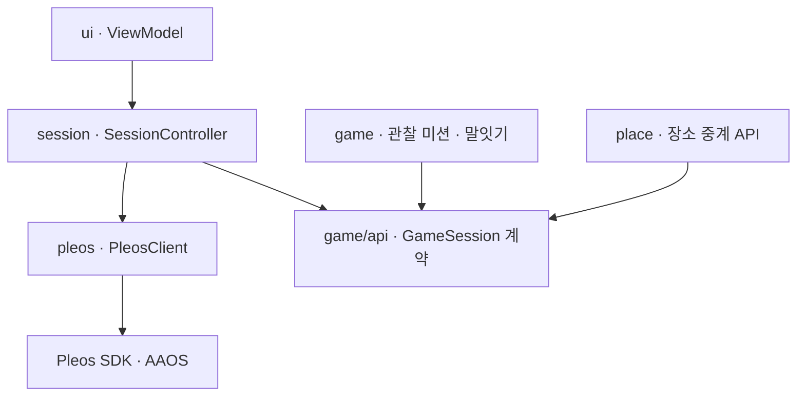
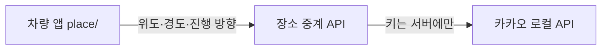

# 구조 안내 — 안드로이드를 몰라도 읽을 수 있게

이 문서는 코드와 함께 자동 검사된다(`scripts/check-docs.sh`). 진입점·패키지가 생기거나 의존 관계가 바뀌면 이 문서도 같이 바뀌어야 커밋된다.
F-22(구조 전환)부터 설계서(docs/backseat-system-architecture.md) 구조와 실제 코드가 같다.

## 한 문장 구조
차량 신호와 음성은 `pleos/`의 PleosClient가 Pleos SDK에서 받아 오고 → `session/`의 SessionController가 시작·멈춤·휴식·종료를 한곳에서 정하며 → 놀이 내용은 `game/`이 GameSession 계약(`game/api`)으로만 돌려주고 → `ui/`는 상태만 보여준다.



## 진입점 (안드로이드가 우리 앱을 "깨우는" 곳)
안드로이드 앱에는 main() 함수가 없다. 대신 안드로이드가 manifest에 적힌 클래스를 상황에 맞게 실행한다. 이것이 진입점이다.
| 진입점 | 종류 | 언제 실행되나 | 하는 일 |
|---|---|---|---|
| App | Application | 앱 프로세스가 처음 뜰 때 1번 | Pleos SDK 초기화, 객체 연결(의존성 주입) |
| MainActivity | Activity(화면) | 사용자가 앱 아이콘을 누를 때 | 상태 화면 표시, 이용 시작, 녹음 화면(SC-08) 전환 |
| SimReceiver | BroadcastReceiver (debug 빌드만) | `scripts/sim.sh`가 신호를 보낼 때 | 가짜 차량 신호·인식 결과를 `SimPleosClient`에 전달해 자동 검증 |

## 패키지와 의존 규칙
| 패키지 | 역할 | 의존해도 되는 곳 |
|---|---|---|
| pleos/ | Pleos SDK 경계. PleosClient 인터페이스 하나 + Pleos 구현(pleos/sdk) + Fake(pleos/fake) | 없음(가장 아래층) |
| game/api/ | 게임 연결 계약(GameSession, GameInput, GamePlan, GameNext, GameMessage, PlaceSource) | 없음 |
| game/ | 놀이 내용(관찰 미션, 말잇기, 대화 규칙)과 createGame | game/api |
| place/ | PlaceSource HTTP 구현·Fake(F-16) | game/api |
| session/ | SessionController(이용 흐름·멈춤·휴식·종료·입력 시도), 결정표, 음성 제어 판별, 목소리 카드 재생 시점과 VoiceCardStore 인터페이스, 목소리 카드 녹음·보관(CardStudio), 위치정보 이용 동의(LocationConsent) | pleos(인터페이스), game/api |
| ui/ | 화면·ViewModel. main(시작·이용·결과), cards(녹음 화면 SC-08) | session |
| di/ | 객체 연결(구체 게임, PleosClient 구현, PlaceSource와 그 위치 공급(동의 뒤에만), 카드 저장소) | 모두 |
| debug/ | SimReceiver·SimPleosClient 등 debug 빌드 전용 | pleos |
금지 예: game → pleos·session·ui, session → 구체 게임 클래스(game.api만), ui → pleos, pleos → 다른 패키지. Pleos SDK(`ai.pleos.*`)와 pleos/sdk는 pleos/·di/·App.kt에서만 import. check-docs.sh가 검사한다. 커버리지(Kover 80%)는 session·game.

## 의존 그래프 (자동 생성 — 손으로 고치지 않는다)
<!-- depgraph:start -->
```mermaid
graph LR
  (root) --> di
  (root) --> ui
  di --> game
  di --> place
  di --> pleos
  di --> session
  place --> game
  session --> game
  session --> pleos
  ui --> session
```
<!-- depgraph:end -->

## 장소 검색 (1차, F-16·F-11)

- 앱에는 카카오 키가 없다. 중계 API가 실패하면 앱은 데이터 없는 미션(F-07)으로 전환한다. 계약은 docs/api-places.md.

## 신호가 흐르는 길 (예: 브레이크)
1. 차량 → Pleos Vehicle SDK 콜백 → `pleos/sdk`가 `PleosClient.vehicle`(StateFlow)의 `brake` 값으로 내보냄. debug 빌드에서는 `debug/SimPleosClient`가 그 위에 `sim.sh` 값을 덮어씀
2. `session/`의 SessionController가 결정표로 판정해 멈춤·재개를 정함(F-03)
3. 화면은 SessionController가 바꿔 준 값(`CarStatus` 등)만 그림. ui는 pleos를 모른다

## 아이 말이 흐르는 길
STT 최종 결과 → SessionController가 제어 요청(재안내·휴식·재개·종료)인지 먼저 판별 → 아니면 열린 응답 차례일 때만 `GameInput.Answer`로 게임에 한 번 전달(입력 시도 ID로 늦은 결과 차단) → 게임이 돌려준 `GamePlan`을 순서대로 재생하고 다음 차례를 연다.
