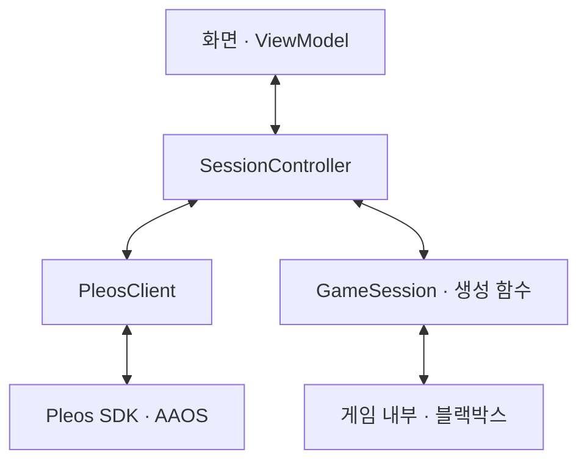

# 벌써도착 공모전용 아키텍처 설계서

개정일: 2026-11-09

**하나의 Android 앱에서 공통 이용 흐름, Pleos 연동, 게임 연결 계약을 구현한다.** 지정한 시연 환경에서 이용 준비부터 종료까지 한 번의 경험을 완결하는 것을 목표로 한다. 게임의 규칙과 콘텐츠는 별도 담당자가 구현하는 블랙박스로 둔다.

## 1 적용 범위와 변경한 정책

이 설계서는 [이용 단계별 필수 기능과 파생 기능](https://chatgpt.com/library?file_id=libfile_391c23a4c85c81918ff26887c6079cc0&account_id=personal)을 바탕으로 다음 출품 범위를 적용한다. 기존 요구사항과 다른 동작은 아래 정책을 따른다.

| 항목 | 출품 범위 |
| --- | --- |
| 실행 환경 | 제출에 사용할 기기 또는 에뮬레이터 한 환경과 SDK·차량 서비스 버전 조합을 정해 사용한다. 언어는 한국어로 한정한다. |
| 코드 구성 | 단일 app 모듈에서 패키지만 구분한다. 공통 진행은 SessionController, SDK 연동은 PleosClient에 모은다. |
| 실행 수명 | 앱을 전면에 둔 상태에서 이용한다. 사용자가 다른 화면으로 이동해 앱을 떠나면 현재 이용을 종료한다. 백그라운드 이용 유지를 위한 별도 서비스를 두지 않는다. |
| 게임 확장 | GameSession 계약과 createGame 생성 함수를 유지한다. 새 이용마다 새 게임 인스턴스를 만든다. |
| 내비 중 요청 | 중단·종료는 처리한다. 재개·재안내 요청은 보관하지 않으며, 사용자는 내비 안내가 끝난 뒤 다시 요청한다. |
| 내비 종료 후 | 내비 때문에만 멈춘 이용은 자동 재개한다. 사용자 요청이나 무응답으로 쉬던 이용은 휴식을 유지한다. |
| 종료 안내 | 종료 음성을 생략한다. 음성 인식·출력·대기 작업을 정리하고 화면에 종료 상태를 표시한다. |
| 음성 명령 | 재안내·휴식·재개·종료의 정해진 한국어 표현부터 지원한다. 다양한 표현 해석은 후순위로 둔다. |
| 상태 보관 | 현재 이용의 진행 위치와 응답만 메모리에 보관한다. 종료한 이용이나 프로세스가 사라진 이용은 복원하지 않는다. |

**앱 발화 중 음성 제어와 실제 내비 안내 감지는 현재 구현 범위에 포함한다.** 두 기능은 추가 축소 후보로만 남아 있으며, 제외하기로 결정한 항목이 아니다. 대상 환경에서 가능한 연동 방법을 먼저 확인한다.

## 2 전체 구성과 책임



| 구성요소 | 책임 |
| --- | --- |
| 화면·ViewModel | 시작 요청과 권한 안내를 제공하고 현재 상태를 표시한다. ViewModel이 컨트롤러를 보유해 화면 재생성만으로 새 이용이 만들어지지 않게 한다. |
| SessionController | 시작 조건, 참여 안내, 응답 접수, 게임 호출, 진행 위치, 휴식·재개·종료를 관리한다. |
| PleosClient | SDK 초기화·호출·구독·해제를 담당한다. 음성·차량·오디오 상태를 컨트롤러가 사용할 이벤트로 전달한다. |
| GameSession과 생성 함수 | 시작과 접수된 응답을 게임에 전달하고, 안내·다음 입력·완료 결과를 받는다. 게임 구현을 선택하는 지점은 생성 함수 한곳으로 모은다. |

기존의 TurnRunner와 GameRunner 역할은 컨트롤러 내부 함수와 비동기 작업으로 처리한다. 음성 조정과 SDK별 Adapter 역할은 PleosClient에 모은다. 별도 Registry, 범용 플러그인 로더, Port별 클래스 분리는 도입하지 않는다.

패키지는 ui, session, pleos, game 정도로 나눈다. **화면은 컨트롤러에 명령을 전달하고, 게임은 PleosClient를 직접 호출하지 않는다.** 구체 게임과 PleosClient를 연결하는 객체 생성은 앱 초기 조립부에서 수행한다.

## 3 게임 연결 계약

게임 담당자와는 외부 입력·출력만 합의한다. 문제·규칙·정답 판정·점수·난이도·콘텐츠와 내부 상태 표현은 게임 내부에서 관리한다.

아래 코드는 팀 간 계약 예시다.

```kotlin
interface GameSession {
    suspend fun step(input: GameInput): GamePlan
    suspend fun close()
}

sealed interface GameInput {
    data object Start : GameInput
    data class Answer(val turnId: String, val text: String) : GameInput
}

data class GamePlan(
    val messages: List<String>,
    val next: GameNext
)

sealed interface GameNext {
    data class AwaitAnswer(
        val turnId: String,
        val prompt: String
    ) : GameNext
    data object Finished : GameNext
}
```

createGame(gameId)는 해당 게임의 새 GameSession을 반환한다. 게임이 하나면 해당 구현을 바로 생성하고, 여러 개면 정적인 분기나 목록을 사용한다. 기존 게임 엔진의 인터페이스가 다를 때만 Adapter를 추가한다.

계약의 실행 규칙은 다음과 같다.

- 게임은 입력을 받아 현재 안내·반응과 다음 응답 차례 또는 완료를 반환한다. 반환한 계획은 실행 중 바뀌지 않는다.
- 앱이 음성을 재생하고 응답 차례를 연다. 게임은 마이크·TTS·차량 SDK를 직접 사용하지 않는다.
- 휴식 중에는 같은 게임 인스턴스를 유지하고 앱의 계획 실행을 멈춘다. 게임 상태를 내보내고 복원하는 기능은 두지 않는다.
- 게임 완료는 계획의 마지막 단계다. 앱이 그 단계에 도달하면 공통 종료 처리를 실행한다. 휴식 중 받아 둔 완료 결과는 재개 전까지 실행하지 않는다.
- step과 close는 완료 가능한 작업이어야 한다. 같은 인스턴스에서 두 작업을 동시에 실행하지 않는다.

새 게임을 추가할 때는 GameSession 구현과 생성 함수의 등록만 변경한다. 공통 이용 정책과 Pleos 연동은 그대로 사용한다.

## 4 다섯 단계의 실행 흐름

| 단계 | 공통 동작 |
| --- | --- |
| **이용 준비** | 주차와 음성 사용 준비를 확인하고 보호자의 화면 시작 요청을 받는다. 확인 불가 상태에서는 시작하지 않는다. 준비 중 출발하면 시작 요청을 취소하며, 다시 주차해도 새 요청이 필요하다. |
| **참여 시작** | 참여 방법과 제어 명령을 안내한다. 실제 인식이 가능한 상태에서 응답 차례를 연다. |
| **놀이 진행** | 최종 인식 결과를 현재 차례의 응답으로 접수한 뒤 게임에 한 번 전달한다. 반환된 안내와 다음 차례를 실행한다. |
| **쉬기 또는 중단** | 일반 발화와 진행을 멈추고 진행 위치와 접수한 답을 유지한다. 제어 요청은 처리하며, 일반 응답은 접수하지 않는다. |
| **종료** | 이용을 먼저 종료 상태로 바꾸고 음성·대기 작업을 취소한다. 종료 음성은 재생하지 않는다. 새 이용은 주차 중 새 시작 요청으로 처음부터 실행한다. |

음성 기능이 정상인데 답을 얻지 못하면 다시 안내하고 응답 기회를 제공한다. 이후에도 답을 얻지 못하면 휴식으로 전환한다. 권한 상실이나 서비스 불가 등으로 기본 음성 참여·제어를 제공할 수 없으면 이용을 종료한다. 개별 발화를 알아듣지 못한 상황과 음성 기능 장애를 구분한다.

### 휴식과 내비 중단

휴식 여부와 내비 안내 여부는 별도로 보관한다. 휴식은 사용자 요청과 반복 무응답을 같은 재개 정책으로 처리한다.

| 상황 또는 요청 | 처리 |
| --- | --- |
| 내비 안내 시작 | 앱 발화와 진행을 멈추고 일반 응답 대기·무응답 판정을 정지한다. |
| 내비 중 중단 요청 | 휴식 상태를 기록한다. 내비가 끝나도 자동 재개하지 않는다. |
| 내비 중 종료 요청 | 즉시 종료한다. |
| 내비 중 재개·재안내 요청 | 저장하거나 예약하지 않는다. 내비 종료 후 다시 요청받는다. |
| 내비 안내 종료 | 휴식 상태가 아니면 미완료 단계부터 자동 재개한다. 휴식 상태이면 명시적인 재개 요청을 기다린다. |
| 휴식 중 재안내 요청 | 재개·종료 방법을 안내한다. 재안내만으로 이용을 재개하지 않는다. |

첫 안내·재안내·휴식·재개 안내에도 내비 양보 정책을 적용한다. 내비 중 발생한 휴식은 화면에 표시하고, 휴식 알림 음성을 나중에 예약 재생하지 않는다.

## 5 Pleos 연동 방식

PleosClient가 실제 SDK 객체와 리스너를 관리한다. 컨트롤러에는 주차 상태, 음성 사용 가능 여부, 인식 결과, 출력 완료·취소, 확인된 외부 중단 정보를 전달한다.

| 기능 | 연결 방법과 처리 기준 |
| --- | --- |
| 주차 확인 | Pleos Vehicle SDK와 대상 환경에서 허용되는 차량 API로 필요한 신호를 조회·구독한다. 앱에는 주차 확인·주차 아님·확인 불가로 전달한다. 기능 지원과 권한을 확인하고, 확인 불가를 주차로 취급하지 않는다.[S1] |
| 음성 입력 | Pleos STT를 사용한다. 인식문에서 제어 요청을 먼저 판별하고, 일반 응답은 현재 열린 입력 차례에서만 접수한다. STT의 요청 준비와 실제 인식 시작을 구분한다.[S2][S3] |
| 음성 출력 | Pleos TTS를 사용한다. 정상 완료와 취소를 구분해, 취소된 발화가 다음 차례를 실행하지 않게 한다.[S4] |
| 오디오 중단 | 대상 환경에서 검증된 신호로 내비 안내 시작·종료를 판단한다. 포커스 상실만으로 원인을 내비라고 단정하지 않는다.[S5][S6] |
| 화면 제한 | 현재 환경의 주행 중 화면 제한을 반영한다. 주차 확인과 화면 조작 가능 여부는 별도로 판단한다.[S7] |

STT·TTS는 ON_DEVICE 모드를 명시하고, 사용할 수 없을 때 서버 모드로 자동 전환하지 않는다. 공식 문서의 기본값인 HYBRID는 서버 처리를 사용할 수 있으므로 모드 생략으로 온디바이스 처리를 보장할 수 없다.[S2][S8]

### 먼저 확인할 두 가지 연동

- **앱 발화 중 음성 제어:** 앱이 말할 때도 제어 요청을 받을 수 있어야 하고, 앱 자신의 음성을 사용자 입력으로 처리하지 않아야 한다. SDK·마이크 경로에서 가능한 동시 입출력 방식을 확인한다.
- **실제 내비 발화 감지:** 앱이 말하는 중과 답을 듣는 중 모두 내비 안내의 시작·종료를 구분할 수 있어야 한다. NaviHelper의 공개 이벤트 목록에는 개별 안내 발화의 시작·종료가 명시되어 있지 않으며, 경로 탐색 시작을 음성 시작으로 사용할 수 없다.[S9]

두 항목이 구현되지 않으면 현재 기능 범위를 충족했다고 보지 않는다. 구현 방법이 확보되지 않을 경우 추가 범위 조정 대상으로 다룬다. 시연용 신호 주입은 중단 정책의 시뮬레이션으로 표시하며, 실제 내비 연동과 구분한다.

## 6 단순한 구현에서도 유지할 실행 규칙

### 상태 변경은 한곳에서 처리

화면 명령, STT 결과, TTS 완료·취소, 게임 결과, 차량·내비 이벤트는 SessionController에서 순서대로 처리한다. 별도 이벤트 프레임워크 없이 컨트롤러의 이벤트 처리 함수로 모아도 된다.

컨트롤러는 현재 이용, 실행 위치, 휴식 여부, 내비 안내 여부, 접수한 응답, 실행 중인 게임 작업을 보관한다. 앱 측 입력 허용 상태는 다음 세 가지면 충분하다.

- 이용 전·종료 후: 음성 인식을 유지하지 않는다.
- 안내·휴식·내비 중단·게임 결과 대기 중: 해당 상태에서 허용하는 제어 요청을 처리한다.
- 실제 응답 차례: 제어 요청과 현재 차례의 일반 응답을 처리한다.

### 게임 계산 중에도 중단과 종료 처리

게임 명령은 한 번에 하나씩 비동기로 실행한다. 컨트롤러가 계산을 기다리느라 다른 이벤트 처리를 멈추지 않게 한다.

접수한 답의 계산 도중 휴식하면 결과를 보관하고 발화·다음 차례 실행을 보류한다. 재개 시 그 결과부터 이어가며 같은 답을 다시 전달하지 않는다. 이용이 종료됐다면 늦게 도착한 결과를 폐기한다.

종료 시 미실행 명령을 취소하고 실행 중인 step이 끝난 뒤 close를 호출한다. 논리적인 이용 종료와 음성 정리는 그 완료를 기다리지 않는다. 게임 실행이 실패하면 같은 명령을 자동 재시도하지 않고 이용을 종료한다.

### 늦은 결과와 중복 입력 차단

이용과 입력 시도를 구분하는 식별자를 유지한다. 중단·응답 접수·종료 시 해당 입력 시도를 닫는다. 재개 후 일반 응답을 받을 차례에 도달하면 새 입력 시도를 연다. 이미 접수한 답이 있으면 그 처리 결과와 남은 안내부터 이어간다. 게임의 논리적인 차례가 같아도 이전 시도의 미접수 결과는 받아들이지 않는다.

SDK 콜백이 어느 실제 요청에 속하는지는 PleosClient에서 검증해야 한다. 공개 STT·TTS 콜백에는 요청별 ID가 없으므로, 결과가 도착한 순간의 최신 식별자를 붙이는 것만으로는 이전 결과를 차단할 수 없다. 대상 버전에서 취소와 재시작 순서를 확인하고, 확인한 순서로만 요청을 실행한다.[S3][S4]

### 실제 화면 이탈과 일시적인 가림 구분

사용자가 다른 앱이나 화면으로 이동해 앱을 떠나면 현재 이용을 종료한다. 권한 요청 창, 일시적인 시스템 화면, 오디오 포커스 상실만으로 화면 이탈을 판단하지 않는다. 단, 음성 참여·제어 기능을 제공할 수 없게 된 경우에는 장애 종료 정책을 적용한다.

화면 재생성은 기존 컨트롤러와 이용 상태에 다시 연결한다. 프로세스가 사라진 경우에는 과거 이용을 복원하지 않는다.

## 7 구현 순서와 시연 확인

1. **게임 계약과 시연 환경을 정한다.** GameSession 입력·출력과 생성 지점을 합의하고, 기기·SDK·서비스 버전 조합을 기록한다.
2. **Pleos 연결을 확인한다.** 실제 음성 입출력과 주차 신호를 연결하고, 발화 중 제어·내비 감지의 가능 여부를 먼저 확인한다.
3. **가짜 게임으로 다섯 단계를 완성한다.** 공통 이용 흐름을 게임 개발과 독립적으로 구현한다.
4. **실제 게임을 연결하고 시연 흐름을 점검한다.** 게임 담당자는 GameSession 구현을 제공하고, 전체 앱 담당자는 생성 함수에 연결한다.

시연 전에는 다음 동작을 확인한다.

| 확인 상황 | 기대 결과 |
| --- | --- |
| 주차 중 시작부터 종료까지 | 실제 Pleos 음성 입출력으로 한 번의 이용이 완결된다. 종료 음성은 없다. |
| 주차 확인 불가·준비 중 출발·중복 시작 | 잘못된 새 이용이 만들어지지 않는다. |
| 안내 중 중단·종료 요청 | 요청을 처리하고, 종료 이후 늦은 결과로 진행하지 않는다. |
| 응답 접수 직후 휴식·재개 | 이미 받은 답을 다시 묻거나 중복 반영하지 않는다. |
| 내비만 중단·휴식과 내비가 겹침 | 전자는 자동 재개하고 후자는 휴식을 유지한다. 내비 중 재개·재안내 요청은 나중에 실행되지 않는다. |
| 실제 화면 이탈·권한 창·화면 재생성 | 실제 이탈은 종료하고, 단순 가림이나 재생성은 새 이용을 만들지 않는다. |
| 무응답·음성 기능 불가 | 무응답은 재안내 후 휴식, 기능 불가는 종료로 처리한다. |

## 8 담당 범위

| 담당 | 결과물 |
| --- | --- |
| 전체 앱 담당 | 화면, SessionController, PleosClient, 게임 생성 지점, 공통 이용 정책과 실제 연동 확인 |
| 게임 담당 | GameSession 구현 또는 필요한 Adapter, 내부 게임 규칙·콘텐츠·상태 관리 |

전체 앱 담당자는 게임 내부 구현을 알 필요 없이 공통 계약으로 이용을 실행한다. 게임 담당자는 주차·음성 자원·내비 양보·휴식·종료를 게임마다 다시 구현하지 않는다.

## 공식 자료

- [S1 Pleos Vehicle SDK](https://document.pleos.ai/en/docs/pleos-only/connect-sdk-pleos/Vehicle/intro)
- [S2 Pleos SpeechToText 소개와 실행 모드](https://document.pleos.ai/en/docs/pleos-only/connect-sdk-pleos/SpeechToText/intro)
- [S3 Pleos SpeechToText 결과 리스너](https://document.pleos.ai/en/docs/pleos-only/connect-sdk-pleos/SpeechToText/result-listeners)
- [S4 Pleos TextToSpeech 이벤트 리스너](https://document.pleos.ai/en/docs/pleos-only/connect-sdk-pleos/TextToSpeech/event-listeners)
- [S5 Pleos Audio Focus 가이드](https://document.pleos.ai/en/docs/pleos-only/vehicle-app-developer-guide/audio-focus-development-guide/audio-focus-development)
- [S6 Android Automotive Audio Focus](https://source.android.com/docs/automotive/audio/audio-focus)
- [S7 Pleos 주행 중 화면 제한](https://document.pleos.ai/en/docs/pleos-only/vehicle-app-developer-guide/driving-restriction-development-guide)
- [S8 Pleos TextToSpeech 소개와 실행 모드](https://document.pleos.ai/en/docs/pleos-only/connect-sdk-pleos/TextToSpeech/intro)
- [S9 Pleos NaviHelper 이벤트 리스너](https://document.pleos.ai/en/docs/pleos-only/connect-sdk-pleos/NaviHelper/event-listeners)
